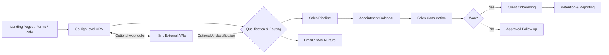
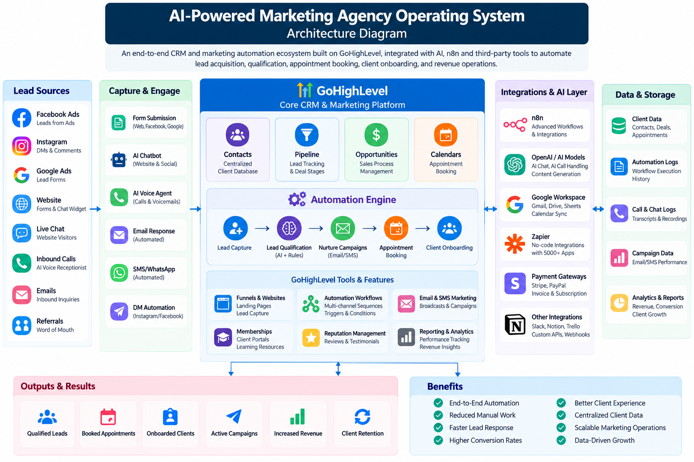
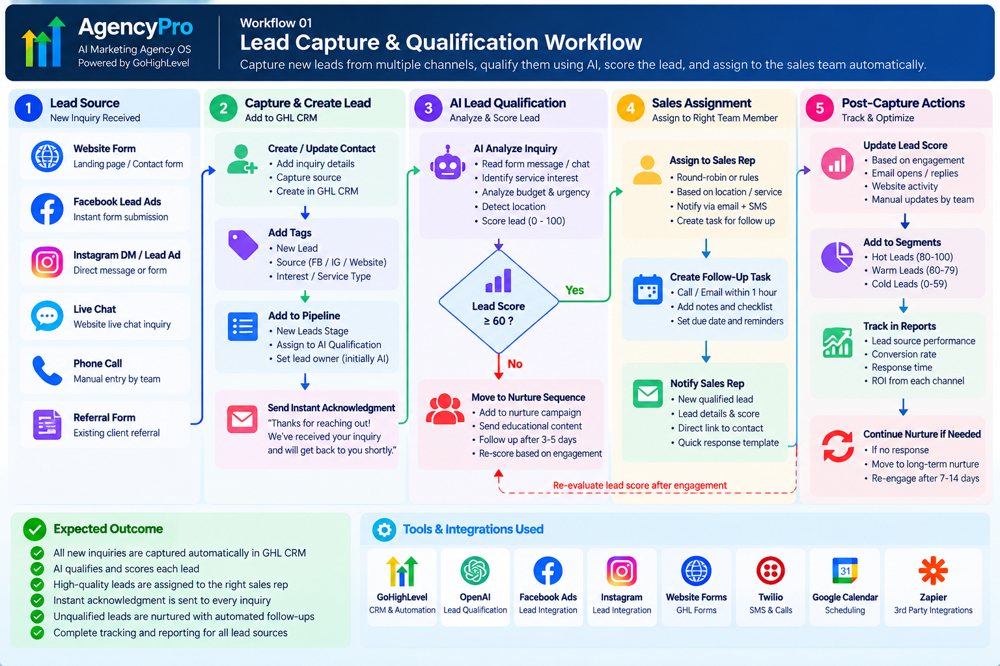
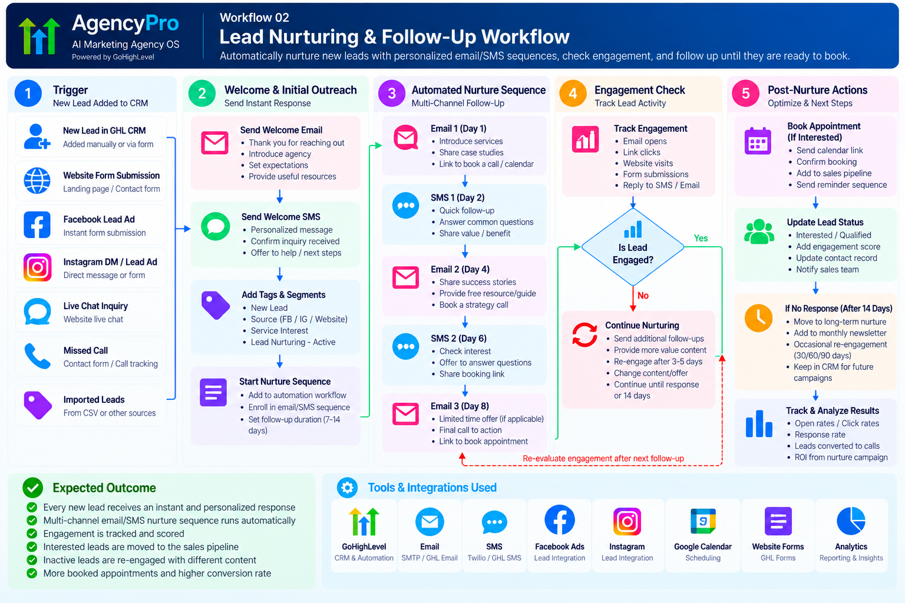
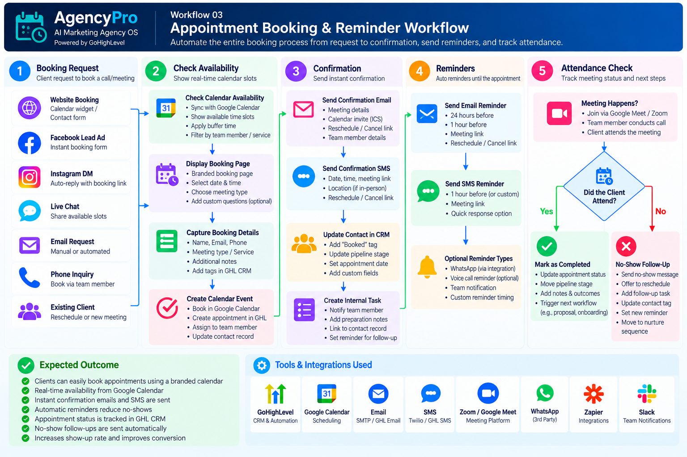
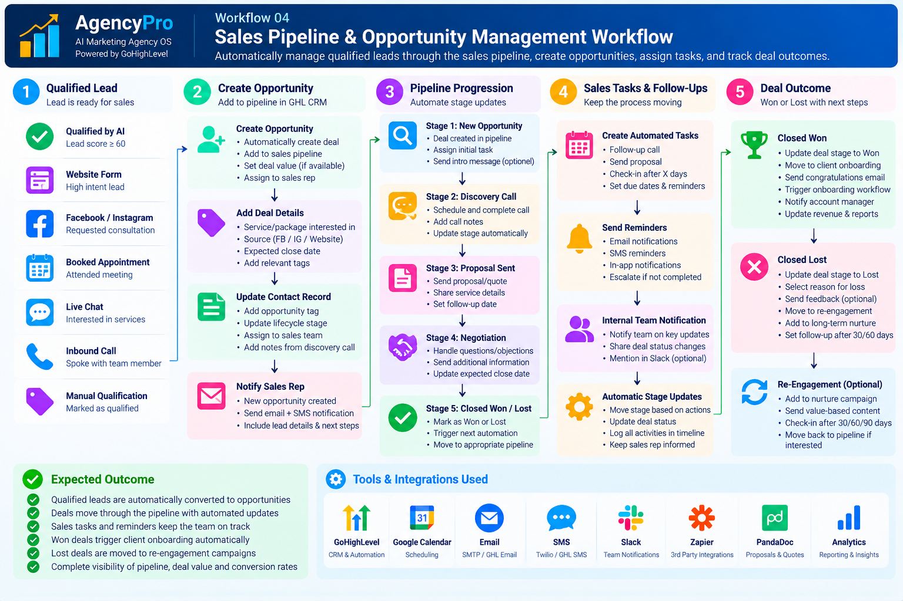
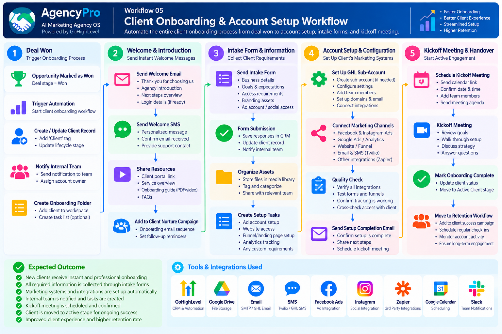
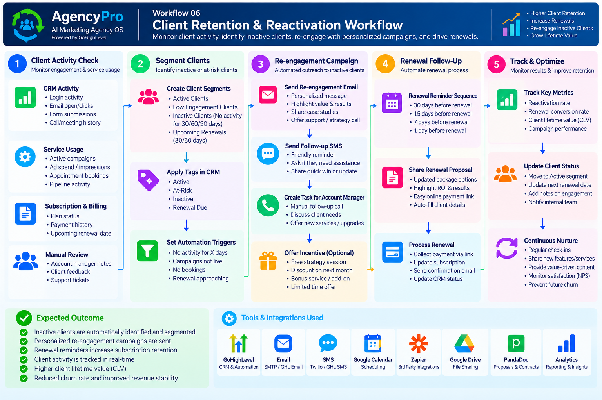
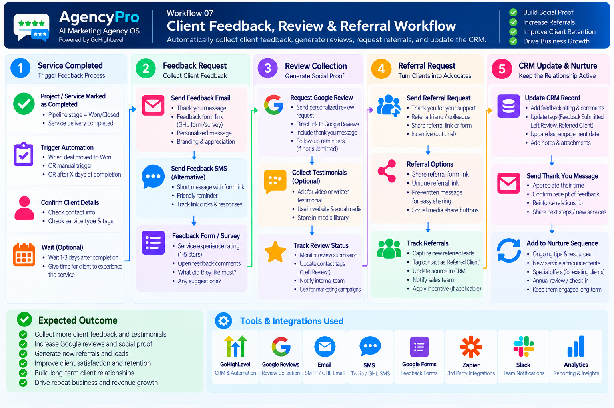

# AI-Powered Marketing Agency Operating System

**A GoHighLevel-centered CRM and marketing automation solution blueprint for agencies managing lead acquisition, qualification, appointment booking, sales pipelines, onboarding, and client retention.**

> **Project status:** Documentation and solution design prepared. Live GoHighLevel configuration, integrations, and end-to-end testing are **not yet verified**. Screenshots, metrics, and demonstrations will be added only after implementation.

## At a Glance

| Attribute | Details |
|---|---|
| Project type | Portfolio / solution architecture and implementation project |
| Primary platform | GoHighLevel (GHL) |
| Optional integrations | n8n, AI model API, calendar, email/SMS providers, webhooks |
| Target users | Digital marketing agencies, lead-generation agencies, B2B service providers |
| Primary goal | Reduce manual lead handling and improve visibility across the lead-to-client lifecycle |
| Current stage | Phase 2 — Documentation and architecture |

## Business Challenge

Growing agencies often use disconnected tools for forms, lead qualification, appointment scheduling, client communication, and reporting. This creates delayed follow-ups, inconsistent lead ownership, and poor pipeline visibility.

## Proposed Solution

A centralized operating model in GoHighLevel with configurable automations for:

1. **Lead capture:** Intake from landing pages, forms, ads, and supported integrations.
2. **Qualification:** Capture budget, service interest, urgency, and fit; optionally use AI-assisted categorization with human review.
3. **Routing:** Assign leads by service, location, priority, or sales representative availability.
4. **Nurturing:** Trigger consent-aware email and SMS sequences with stop conditions.
5. **Booking:** Provide calendar links, confirmations, reminders, and rescheduling paths.
6. **Pipeline management:** Track prospects through clearly defined opportunity stages.
7. **Client onboarding:** Create handoff tasks and send approved onboarding communications.
8. **Retention and reporting:** Track engagement, follow-ups, and operational KPIs.

## High-Level Architecture

### Visual System Architecture

The diagram below illustrates the proposed GoHighLevel CRM, AI automation, lead acquisition, integrations, and reporting architecture.

## Proposed CRM Pipeline

`New Lead → Contact Attempted → Engaged → Qualified → Appointment Booked → Proposal Sent → Won / Lost`

Each stage requires explicit entry criteria, an owner, and a defined next action. See [CRM & data model](docs/02-crm-data-model.md).

## Core Workflow Catalog

| ID | Workflow | Trigger | Intended outcome |
|---|---|---|---|
| WF-01 | New lead intake | Form submission / supported webhook | Create or update contact and opportunity |
| WF-02 | Lead qualification | Intake completed | Score, categorize, and route lead |
| WF-03 | Speed-to-lead follow-up | New eligible lead | Send compliant acknowledgment and assign owner |
| WF-04 | Appointment management | Booking / cancellation / reschedule | Confirm, remind, and update pipeline |
| WF-05 | No-show recovery | Appointment marked no-show | Offer rescheduling path |
| WF-06 | Proposal follow-up | Opportunity moved to Proposal Sent | Schedule owner tasks and approved follow-ups |
| WF-07 | Client onboarding | Opportunity marked Won | Launch checklist and welcome communications |
| WF-08 | Re-engagement | Approved inactivity threshold | Start consent-aware win-back sequence |

Full design: [Automation workflows](docs/03-automation-workflows.md).

## Technology Stack

- **GoHighLevel:** Contacts, custom fields, opportunities, workflows, calendars, forms, and communications.
- **n8n (optional):** Orchestration, webhook processing, third-party integrations, and controlled retries.
- **AI API (optional):** Structured lead classification or message drafting, subject to validation and privacy controls.
- **GitHub:** Documentation, change history, configuration references, and evidence.

Exact feature availability depends on the GHL subscription, configuration, and connected providers.

## Security & Responsible Automation

- Do not commit API keys, credentials, tokens, or real client personal data.
- Enforce least-privilege permissions and use a secret manager for integrations.
- Obtain and record appropriate marketing consent; honor opt-outs and suppression lists.
- Validate webhook signatures or equivalent authentication where supported.
- Avoid sending sensitive client information to AI services without authorization.
- Include error handling, retries, duplicate detection, and human escalation.
- Follow applicable privacy and messaging requirements for the deployment region.

## Success Metrics (To Be Measured)

Lead response time, lead-to-qualified conversion rate, booking rate, show rate, proposal-to-win rate, and automation failure rate. **No performance uplift is claimed at this stage.**

## Implementation Roadmap

1. Confirm business requirements, permissions, consent model, and baseline KPIs.
2. Configure GHL account structure, users, calendars, custom fields, and pipeline.
3. Build intake forms and contact deduplication rules.
4. Implement workflows in controlled order and test each trigger/exit condition.
5. Configure optional n8n / AI integrations and error monitoring.
6. Perform UAT using synthetic leads and documented test cases.
7. Deploy, monitor, and capture genuine evidence and demo walkthroughs.

See [Implementation plan](docs/05-implementation-plan.md) and [Test plan](docs/06-test-plan.md).

## Documentation

| Document | Purpose |
|---|---|
| [01 — Project Overview](docs/01-project-overview.md) | Objectives, scope, personas, acceptance criteria |
| [02 — CRM & Data Model](docs/02-crm-data-model.md) | Pipeline, fields, lifecycle and data governance |
| [03 — Automation Workflows](docs/03-automation-workflows.md) | Detailed workflow logic and guardrails |
| [04 — Integrations & Architecture](docs/04-integrations-architecture.md) | System boundaries, integration patterns, security |
| [05 — Implementation Plan](docs/05-implementation-plan.md) | Ordered build procedure and deliverables |
| [06 — Test Plan](docs/06-test-plan.md) | Functional, negative, and UAT test cases |
| [07 — Evidence & Demo Checklist](docs/07-evidence-demo.md) | Real screenshot and demo capture checklist |

## Current Progress

- [x] Repository created (confirmed by user screenshot)
- [x] README and initial design documentation prepared
- [ ] GHL account configuration completed and verified
- [ ] Pipelines, forms, and workflows built
- [ ] Optional integrations configured
- [ ] Functional tests and UAT passed
- [ ] Real screenshots and video demo published

## Automation Workflow Diagrams

The following diagrams illustrate the seven core automation workflows designed for the AI-Powered Marketing Agency Operating System. These are proposed workflow designs; live GoHighLevel implementation and testing will be documented separately.

### 01. Lead Capture & AI Qualification

### 02. Lead Nurturing

### 03. Appointment Booking

### 04. Sales Pipeline Automation

### 05. Client Onboarding

### 06. Retention & Reactivation

### 07. Feedback & Referrals

## Portfolio Note

This repository documents a proposed implementation and is intended to become a working, evidence-backed portfolio case study. Features marked as planned should not be represented as already deployed for a client.

## Contact

For project discussions, reach out through the GitHub profile: [samaviaabid737-cloud](https://github.com/samaviaabid737-cloud).
